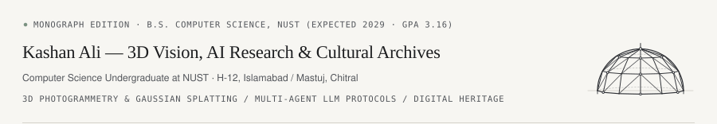
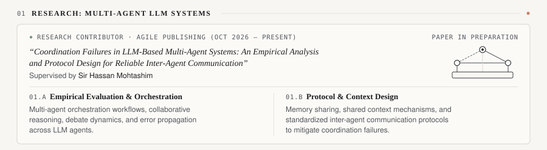
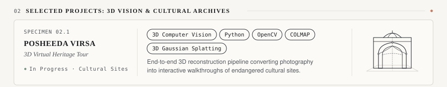
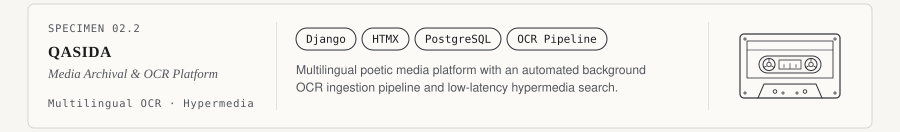
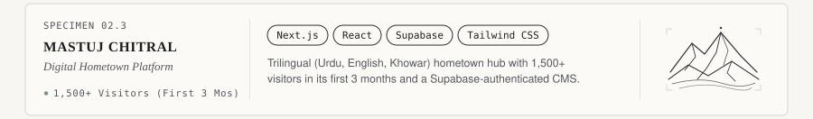
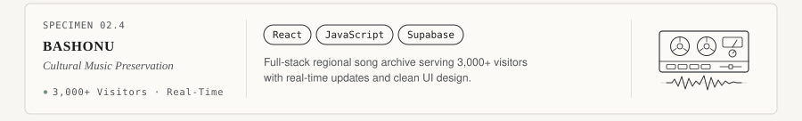
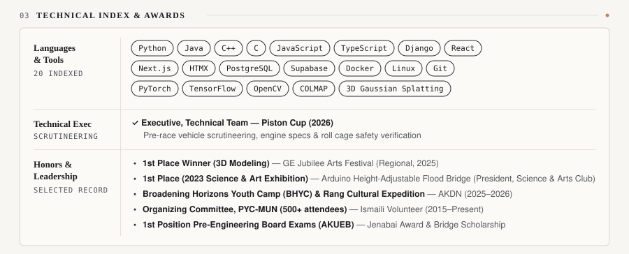

  
  
  
  
  
  
  

  
    <code>COLOPHON · NUST H-12, ISLAMABAD / MASTUJ, CHITRAL</code> 
    <a href="https://kashan.dev"><b>kashan.dev</b></a> &nbsp;·&nbsp;
    <a href="mailto:kashanali.akhsss@gmail.com"><b>Email</b></a> &nbsp;·&nbsp;
    <a href="https://www.linkedin.com/in/kashan-ali-khan/"><b>LinkedIn</b></a> &nbsp;·&nbsp;
    <a href="https://github.com/Kashan-A1i"><b>GitHub</b></a>
  

